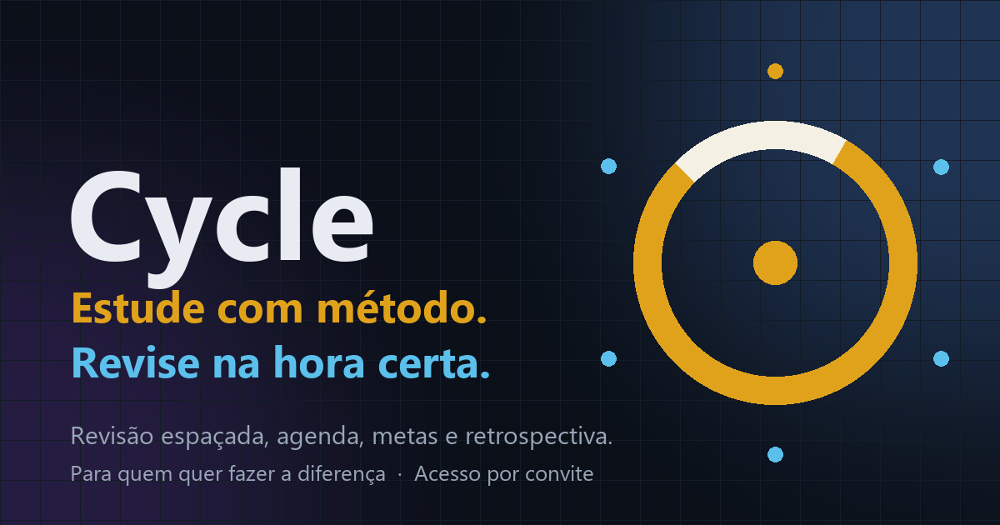

 

# Cycle

**Revisão espaçada para estudar para provas.** 
Grátis · sem anúncios · sem rastreamento · funciona offline

 

---

## Para que serve

Quem estuda para prova esquece o que viu na semana anterior. O Cycle agenda **revisões nos dias certos** (1, 3, 7, 14 e 30 dias depois de cada conteúdo, ajustáveis), aproxima as revisões quando a prova chega perto e junta tudo numa agenda só: aulas, provas, trabalhos, metas e notas.

O uso é **por convite**: cada pessoa tem a sua conta e só ela vê os próprios dados.

 
Aponte a câmera do celular para abrir

## O que faz

| | Recurso | Em uma frase |
|---|---|---|
| 🗓️ | **Agenda** | Lista ou semana, com aula, prova, trabalho e compromisso em cores fixas. O botão **Fim de semestre** fecha o ciclo. |
| 🔁 | **Hoje** | As revisões do dia, com **Assisti** e **Faltei**, sempre na hora certa. |
| 📚 | **Matérias** | Cadastro de matérias, horários, ementa e tópicos. |
| 📄 | **Planos de ensino em PDF** | Lê os PDFs no próprio aparelho, mostra uma prévia e cria matérias, ementas e tópicos que faltam. |
| 🎯 | **Metas** | Estudo líquido da semana por matéria (só conta com o cronômetro rodando) e meta semanal. |
| 📝 | **Provas e Notas** | Pesos, substitutiva, o que falta para passar e simulação "e se…". |
| 📈 | **Retrospectiva** | Horas, constância e superações do semestre, com resumo para baixar. |
| ✍️ | **Anotações** | Em Markdown, por matéria e por tópico. |
| 🔄 | **Importar e exportar agenda** | `.zip` do Google, `.ics` do Apple, Outlook e outros. |
| 🤖 | **IA sem chave** | Monta o pedido pronto (ementa e critérios) para ChatGPT, Gemini ou Claude, copia e abre o chat. |
| 🧭 | **Tour guiado** | Passeio pelas abas, no botão Tour. O cartão **Comece por aqui** leva você nos primeiros passos. |

## Conta e dados

- Crie a conta com e-mail e senha e **confirme o e-mail**. Só e-mails convidados entram.
- Os dados ficam **no aparelho e na sua conta** (Firebase, plano gratuito), para abrir em outro aparelho.
- O primeiro acesso precisa de internet. Depois funciona **offline** e sincroniza quando a conexão volta.
- Entre dois aparelhos da mesma conta, sem internet, dá para passar os dados por **QR animado ou código**.
- **Backup em arquivo** (`.json`) em *Dados e backup*.
- Sem rastreamento e sem anúncios.

## Como instalar

| Aparelho | Como |
|---|---|
| 🤖 **Android** (Chrome) | Abra o site e toque em *Instalar app*. |
| 🍎 **iPhone** (Safari) | Compartilhar › *Adicionar à Tela de Início*. |
| 💻 **Computador** (Edge/Chrome) | Ícone de instalar na barra de endereço. |

## Fora desta versão

Conexão ao vivo com o Google Agenda (a troca é por arquivo), assinar calendário por link e IA própria (os botões "Pedir a uma IA" abrem o seu navegador).

## Para quem quiser mexer

Site estático em **HTML, JavaScript e IndexedDB**, com contas pelo Firebase Authentication e Firestore, publicado pelo GitHub Pages a partir da raiz da branch `main`.

Bibliotecas de terceiros: qrcode-generator, jsQR, pdf.js da Mozilla e o SDK do Firebase (em `lib/`, com as licenças em `lib/LICENSES.txt`).
